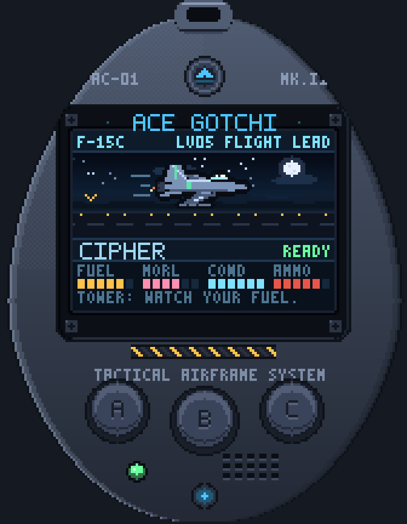

# Ace Gotchi

A desktop **Ace Combat–themed Tamagotchi**. A pixel-art handheld shell sits on
your desktop, always on top and frameless. Inside its green LCD lives a tiny
fighter aircraft with a pilot's soul: keep it fed, rested, polished and
armed, then send it into auto-battled dogfights against the other nations of
Strangereal.

Everything is drawn at **108x74 logical pixels** and upscaled with
nearest-neighbour, so the whole game looks like a 1990s LCD toy.



```
   ______________________
  /  [  ACE GOTCHI  ]    \
 |   +----------------+   |
 |   |   __/          |   |
 |   |  /  \  ->      |   |
 |   |  \__/          |   |
 |   +----------------+   |
 |    (A)    (B)    (C)   |
  \______________________/
```

---

## Requirements

- **Windows** (the window tricks and sound use Win32 APIs).
- **Python 3.11 or newer** — tested on **3.13**. Tkinter is included with the
  standard Python installer, so no `pip install` is needed.
- No Node.js, no PyInstaller, no build step.

If `python` is not on your PATH, re-run the Python installer and tick
*Add python.exe to PATH*.

### Privacy and safety

The game uses only the Python standard library, makes **no network requests**,
collects **no telemetry**, and writes exactly one file: `save.json` next to
`main.py`. Sound is synthesised in memory with `winsound`; there are no
bundled binaries, downloaded assets, or `eval`/`exec` calls.

---

## Launching

Double-click **`Ace Gotchi.vbs`** — it finds `python.exe` on your PATH, prefers
the windowless `pythonw.exe` next to it, and starts the game with no console.

`Ace Gotchi.bat` does the same thing but keeps a console window open, which is
handy when something goes wrong and you want to read the traceback.

You can also run it manually:

```bat
python main.py
```

---

## Controls

| Input | Action |
|---|---|
| Left-click **A / B / C** buttons | A = left, B = select, C = right |
| Drag the shell body | Move the device around the screen |
| `A` / `Left` | Left |
| `B` / `Enter` / `Space` | Select / confirm |
| `C` / `Right` | Right |
| `Esc` or right-click | Device menu |
| `Ctrl+Q` | Quit |

The device menu contains **Save now**, **Always on top**, **Sound**, **Size**
(2x–5x), **Pause care**, **Reset device…** and **Quit**. The window position
and size are remembered in the save file.

---

## The care loop

The aircraft has four stats, all 0–100:

| Stat | What it means |
|---|---|
| **FUEL** | Hunger. Low fuel damages condition over time. |
| **MORL** (morale) | How much the pilot wants to fly. |
| **COND** (condition) | Airframe health. Low condition blocks sorties. |
| **AMMO** | Rounds left. Every sortie burns 30. |

Stats decay in real time — roughly **5.2 fuel/hour**, **3.1 morale/hour** and
**1.1 condition/hour** (double condition decay while fuel is below 25).
Decay continues while the game is closed, capped at **18 hours**. Use
*Pause care* in the device menu if you need a break from the neediness.

### Care actions (main menu)

| Action | Effect | Cooldown |
|---|---|---|
| **FEED** | +26 fuel, +2 morale | 25 s |
| **REST** | +14 condition, +8 morale | 200 s |
| **POLISH** | +10 condition, +5 morale | 150 s |
| **TRAIN** | +14 + level XP, −7 fuel, −4 condition | 70 s |
| **REARM** | 45 CR → ammo back to 100 | — |
| **REPAIR** | 90 CR → +42 condition | — |

### Sortie requirements

A sortie is blocked unless **fuel ≥ 18**, **condition ≥ 20** and
**ammo ≥ 30**. Launching costs **30 ammo** and **8 fuel**; a loss also costs
**16 condition** and **11 morale**.

---

## Dogfights

Sorties are **auto-battlers**: you pick a tactic on the briefing screen, then
watch the round-by-round exchange play out. The HUD always shows **who you fly
as** (your nation's flag and name, bottom row) and **who you fly against**
(the enemy flag and name, top row), with the faction codes repeated in the
footer (`OSEA VS BELK`).

### Tactics

| Tactic | Damage | Evasion | Damage taken | Note |
|---|---|---|---|---|
| **AGGRESSIVE** | x1.38 | x0.92 | x1.15 | +ATK −EVA |
| **BALANCED** | x1.10 | x1.00 | x1.00 | Even fight |
| **EVASIVE** | x0.86 | x1.18 | x0.92 | +EVA −ATK |

All three win about **60–75%** of sorties at every level, within a few points
of each other. Aggressive finishes fights faster; evasive keeps more hull
(about 0.43 of your HP versus 0.37), which pays out in credits because the
win bonus scales with remaining hull.

### Payouts

- **Win:** `55 + enemy level × 14 + 70 × hull remaining` credits and
  `22 + enemy level × 3` XP.
- **Loss:** 12 credits and 8 XP (a lesson is still a lesson).

### Ranks

| Level | Rank |
|---|---|
| 1 | RECRUIT |
| 3 | WINGMAN |
| 5 | FLIGHT LEAD |
| 7 | SQUADRON LDR |
| 10 | ACE |
| 13 | ACE OF ACES |
| 16 | LEGEND |

Levels cost `35`, then `20 + level × 15` XP each, up to level 30. Every level
adds **+4 HP, +0.8 ATK, +0.5 AGI, +0.35 DEF**.

---

## Hangar and fleet

Each airframe tracks its own XP and its own three upgrade lines. Upgrades cost
`90 + 70 × current level` and cap at level 5.

| Upgrade | Effect per level |
|---|---|
| **WEAPONS** (GUN) | +3 ATK |
| **ARMOR** (ARM) | +12 HP |
| **ECM** | +2 AGI |

### Aircraft

| Aircraft | Cost | Req. level | HP | ATK | AGI | DEF | Character |
|---|---|---|---|---|---|---|---|
| F-15C EAGLE | free | 1 | 100 | 13 | 10 | 12 | Balanced starter |
| F-14D TOMCAT | 400 | 3 | 112 | 14 | 9 | 13 | Tough fleet defender |
| MiG-29A FULCRUM | 520 | 5 | 90 | 13 | 15 | 8 | Fast, fragile |
| A-10A WARTHOG | 650 | 6 | 150 | 11 | 4 | 18 | Flying gun, flying brick |
| Su-37 TERMINATOR | 1000 | 9 | 94 | 17 | 16 | 9 | Most agile airframe |
| F-22A RAPTOR | 1500 | 12 | 108 | 18 | 15 | 12 | Endgame stealth fighter |

The unlock requirement uses your **best aircraft's level**, so levelling any
plane opens the rest of the fleet.

The list ends with a **BACK** row — select it and press **B** to return to the
main menu (the footer changes to `B BACK` when it is highlighted).

### Factions

You declare allegiance once on first boot and can change it any time from
**ALLEGIANCE**. Your aircraft wears your nation's livery; enemies are always
drawn from a **different** faction, so the match-up is never a mirror.

| Faction | Code | Colours | Motto |
|---|---|---|---|
| **Osea** | OSEA | blue / white | Defend the continent |
| **Belka** | BELK | grey / red | The north remembers |
| **Yuktobania** | YUKT | olive / gold | Strength through steel |
| **Erusea** | ERUS | mauve / pink | For the princess |
| **FCU** | FCU | sand / teal | Unity of the centre |
| **Sotoa** | SOTA | green / white | Green skies, sharp wings |

---

## Saving

Progress lives in **`save.json`**, created next to `main.py`. It is written
atomically, autosaved every 45 seconds, on window move, on quit, and after
every care action / sortie.

To start over, use **Reset device…** in the right-click menu, or close the game
and delete `save.json`.

---

## Troubleshooting

**Nothing happens when I double-click the `.vbs`.**
Run `Ace Gotchi.bat` instead — it keeps a console open so you can read the
error. The usual cause is Python not being on PATH. Some antivirus tools flag
`.vbs` launchers on principle; `Ace Gotchi.bat` or `python main.py` is the
same thing without the script wrapper.

**The window has a magenta fringe.**
The shell uses colour-key transparency (`#ff00ff`). If you see magenta, the
art has a stray key-coloured pixel; please report it rather than editing the
palette.

**The window is too large / too small.**
Right-click → **Size** → pick 2x–5x. The choice is saved.

**The game is too needy.**
Right-click → **Pause care**, or edit `save.json` (all stats are 0–100).

**I can't type A/B/C.**
Click the device once to focus it; the window fights for focus because it is
frameless and always on top.

**No sound.**
Check right-click → **Sound**. Sound is synthesised in memory with `winsound`,
so there are no audio files to lose.

---

## Developer scripts

These live in the project root and are not needed to play:

| Script | Purpose |
|---|---|
| `python dev_screens.py` | Renders all 12 screens into `preview/screens.png` as a contact sheet. |
| `python dev_zoom.py briefing battle result hangar menu home` | Renders individual screens at 8x into `preview/zoom_*.png`. |
| `python dev_flow.py` | Headless-ish regression: boots, declares allegiance, feeds, sorties, upgrades, changes faction, saves and reloads. Uses a temporary save folder, so your real save is untouched. |

The rendering pipeline is deliberately simple: `PixBuf` → `PhotoImage.put()`
→ `.zoom(scale)`. `acegotchi/pixel.py` holds the drawing primitives,
`font.py` the 5x7 and 3x5 fonts, `sprites.py` the procedural 40x18 jets,
`shell.py` the plastic case, `screens.py` the UI, `dogfight.py` the battle
simulation and renderer, and `state.py` all the rules.

---

## Licence and disclaimer

The source code in this repository is released under the **MIT Licence** — see
[`LICENSE`](LICENSE). You are free to use, modify, and share it.

This is an **unofficial, non-commercial fan project**. It is not affiliated
with, endorsed by, or supported by Bandai Namco Entertainment or Project Aces.
*Ace Combat*, the aircraft designations and names, and the faction names
(Osea, Belka, Yuktobania, Erusea, FCU, Sotoa) are trademarks of their
respective owners and are used here only in a descriptive, fan-work sense.

No assets from any commercial game are included. Every sprite, flag, font, and
sound in this repository is generated at runtime by the code in `acegotchi/`,
and the chiptune effects are synthesised in memory with `winsound`.

If a rights holder objects to this project, open an issue and it will be
taken down.

---

*Fan project. Not affiliated with Bandai Namco. Fly safe.*
